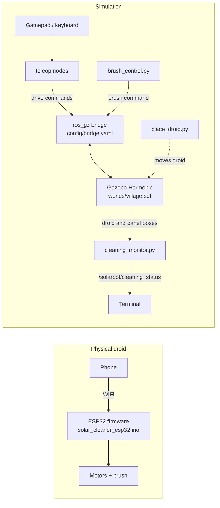

# SolarBot: rooftop solar-panel cleaning droid

**Electricity Group 2 · NUST · Low-cost, phone-controlled, simulation-first**

SolarBot is a student-budget wheeled droid that cleans the solar panels on rural house roofs. A technician places it on a panel and drives it from a **phone** while a front rotating brush sweeps the glass. Dusty panels lose output, and climbing a roof with a bucket is slow and risky, so the idea is a cheap machine that does the sweeping while the technician stays in control from a safe spot.

This repository has two parts:

- **The physical droid:** ESP32 firmware and build notes, driven from a phone.
- **The simulation:** a Zimbabwean village with modern corrugated-iron houses and thatched rondavels (7 houses, 26 rooftop panels), the droid, and a monitor that reports how clean each panel is. It is built on ROS 2 Jazzy and Gazebo Harmonic, and is controlled with a gamepad or keyboard for testing.

```
        N (+y)   panels face north (southern hemisphere)
        ^
        |   modern_1 + ladder + technician
        +--> E (+x)      7 houses, 26 rooftop panels, trees, water tank, dirt road
```

## Contents

1. [Features](#features)
2. [Phone control (physical droid)](#phone-control-physical-droid)
3. [Simulation quick start](#simulation-quick-start)
4. [Simulation controls](#simulation-controls)
5. [How it works](#how-it-works)
6. [Repository layout](#repository-layout)
7. [Everyday tasks](#everyday-tasks)
8. [Project documents and demo](#project-documents-and-demo)
9. [Team and roles](#team-and-roles)
10. [Contributing](#contributing)
11. [Scope, roadmap and known limitations](#scope-roadmap-and-known-limitations)
12. [Troubleshooting](#troubleshooting)
13. [Licence](#licence)

## Features

- **Phone control:** drive the droid and switch the brush on and off from a phone, with no extra controller to carry.
- **Low cost:** two geared motors, caster, front brush, ESP32, motor driver and battery.
- **Realistic simulation:** a full village with 26 rooftop panels, including thatched rondavels with a timber panel rack.
- **Cleaning monitor:** reports when a panel is at least 95 % swept.
- **One generator:** a single script builds every model, the world and the panel table, so they never drift apart.
- **Repo checker:** `tools/check_repo.py` validates XML, `model://` links and the panel table.

## Phone control (physical droid)

The droid is driven from a phone using the firmware in [`solar_cleaner_esp32.ino`](solar_cleaner_esp32.ino).

1. Flash `solar_cleaner_esp32.ino` to the ESP32 with the Arduino IDE.
2. Power the droid and connect your phone to the droid's wireless network.
3. Open the controller page on your phone. The address is printed in the Arduino Serial Monitor at start-up.
4. Place the droid on the panel and drive it with the on-screen controls.

| Phone control | Action |
|---|---|
| Drive buttons | Forward, back, left, right |
| Brush button | Brush on / off |
| Stop button | Stop all motors |

Wiring, parts list and build notes are in [`docs/physical_droid.md`](docs/physical_droid.md).

> **Safety:** keep the droid within sight, stop it before lifting it off the roof, and never leave it running unattended on a panel.

## Simulation quick start

**Requirements:** Ubuntu 24.04 with ROS 2 Jazzy and Gazebo Harmonic already installed.

```bash
# 1. Install the extra ROS packages
sudo apt install ros-jazzy-ros-gz ros-jazzy-joy ros-jazzy-teleop-twist-joy \
                 ros-jazzy-teleop-twist-keyboard python3-yaml

# 2. Get the code and build it
mkdir -p ~/solarbot_ws/src && cd ~/solarbot_ws/src
git clone https://github.com/<your-org>/solarbot-electricity-group2.git solarbot_sim
cd ~/solarbot_ws && colcon build --packages-select solarbot_sim
source install/setup.bash

# 3. Run everything (world + bridge + gamepad + cleaning monitor)
ros2 launch solarbot_sim sim.launch.py
```

The droid starts on the first panel of `modern_1`, the house with the ladder and the technician.

| I want to... | Command |
|---|---|
| Run without a gamepad plugged in | `ros2 launch solarbot_sim sim.launch.py gamepad:=false` |
| Run only the gamepad nodes | `ros2 launch solarbot_sim teleop.launch.py` |
| Just look at the village (no ROS) | `scripts/run_world_only.sh` |

> Run `source install/setup.bash` in every new terminal.

## Simulation controls

The simulation uses a gamepad or keyboard. The phone controller above is for the physical droid.

### Gamepad (Xbox layout)

| Control | Action |
|---|---|
| **Hold LB** | Deadman: the droid only drives while LB is held |
| Left stick | Forward / back and turn |
| RB | Turbo |
| A | Brush on / off |
| B | Stop |

### Keyboard (no gamepad)

```bash
# Terminal 1: drive
ros2 run teleop_twist_keyboard teleop_twist_keyboard

# Terminal 2: brush (only if brush_control is not already running)
ros2 run solarbot_sim brush_control.py &
ros2 topic pub --once /brush_toggle std_msgs/msg/Bool "{data: true}"    # brush on
```

### Put the droid on another roof

```bash
ros2 run solarbot_sim place_droid.py --list                     # list every panel
ros2 run solarbot_sim place_droid.py thatched_2_panel_r1_c0     # move the droid there
```

You can also drag the droid with Gazebo's **Transform Control** tool.

### Watch the cleaning

```bash
ros2 topic echo /solarbot/cleaning_status
```

The monitor logs `<panel>: cleaning complete (>=95 %)` when a panel has been swept.

## How it works



- **Phone and ESP32:** the phone sends drive and brush commands to the ESP32, which runs the motors and brush.
- **Teleoperation (sim):** gamepad axes become drive commands via `teleop_twist_joy`, with the deadman (LB) and turbo (RB) set in `config/gamepad.yaml`.
- **Brush (sim):** `scripts/brush_control.py` toggles the brush (A button, or `/brush_toggle`).
- **Cleaning monitor (sim):** `scripts/cleaning_monitor.py` tracks how much of each panel the brush has covered, using the panel poses in `config/panels.yaml`, and publishes progress on `/solarbot/cleaning_status`.
- **Topic bridge (sim):** `config/bridge.yaml` lists the topics shared between Gazebo and ROS 2.

## Repository layout

```
models/                   <- EVERY model except the sun and the ground
  solarbot_droid/         the low-cost droid (2 geared motors, caster, front brush,
                          controller, motor driver, battery)
  solar_panel/            100 W panel (1.00 x 0.67 m) with a dust film
  house_modern/           6 x 4.5 m house, 10 degree corrugated-iron roof,
                          6 panels on the north slope
  house_thatched/         round rondavel, stepped thatch, timber rack with 2 panels
  ladder/  technician/  water_tank/  acacia_large/  acacia_small/  dirt_path/
worlds/village.sdf        sun + ground + the placement of everything in models/
config/                   bridge.yaml, gamepad.yaml, panels.yaml (world pose of every panel)
launch/                   sim.launch.py (everything), teleop.launch.py (gamepad only)
scripts/                  brush_control.py, cleaning_monitor.py, place_droid.py,
                          run_world_only.sh
tools/                    generate_models.py (rebuilds models/world/panels), check_repo.py
test/                     tests
docs/                     TEAM_ROLES.md, physical_droid.md
solar_cleaner_esp32.ino   ESP32 firmware for the physical droid (phone control)
CMakeLists.txt, package.xml   ROS 2 package files
```

**Rule:** every model lives in `models/`. Only the sun and the ground are defined directly in `worlds/village.sdf`.

## Everyday tasks

### Edit the houses, panels or droid

Everything in `models/`, `worlds/village.sdf` and `config/panels.yaml` is **generated by one script**, so houses and panels always agree. Do not hand-edit generated files; change the generator instead.

```bash
python3 tools/generate_models.py      # regenerate models, world and panel table
cd ~/solarbot_ws && colcon build --packages-select solarbot_sim
python3 tools/check_repo.py           # checks XML, model:// links and the panel table
```

Run `check_repo.py` before every pull request.

## Project documents and demo

| Item | Where |
|---|---|
| Project proposal | `SolarBot_Remote_Controlled_Proposal.docx` |
| Full project documentation | `SolarBot_Remote_Controlled_Documentation.docx` |
| AI/ML inspection model and evaluation | [`docs/AI_ML_INSPECTION.md`](docs/AI_ML_INSPECTION.md) |
| Hardware build notes | [`docs/physical_droid.md`](docs/physical_droid.md) |
| Team roles | [`docs/TEAM_ROLES.md`](docs/TEAM_ROLES.md) |
| Simulation screen recording | `solar bot droid world recording.mp4.bz2` (decompress with `bunzip2`) |

## Team and roles

Electricity Group 2, National University of Science and Technology (NUST).

| Role | Member | Student number | GitHub | Main folders / duties |
|---|---|---|---|---|
| Project Manager | Tyrese Mapangisana | N02534462L | @Tyrese | Issues board, milestones, PR approvals, supervisor reports, README/docs |
| Software Engineer | Hope M Chibare | N02532738H | @Hope178 | `launch/`, `config/bridge.yaml`, package structure, code review |
| Systems Engineer | Tawananyasha Tarugarira | N02532657D | @TawanaTarue | `models/`, `tools/generate_models.py`, `docs/physical_droid.md`, hardware build |
| Network Engineer | Precious R Magaya | N02529749P | @Precious | LoRa/WiFi link simulation, message format, POTRAZ rules |
| Programmer 1 | Tafadzwa Chinhoyi | N02529632Q | @tafadzwa0123 | Navigation/docking helpers for the later autonomy phase |
| Programmer 2 | Tinevimbo Chikaka | N02534499J | @tine-20 | `scripts/brush_control.py`, `scripts/cleaning_monitor.py` |
| Test Programmer | Patience Mafira | N02529263K | @patien025 | `tools/check_repo.py`, `test/`, bug reports |
| Database Administrator | Ashton Ndlovu | N02532750L | @Ashera-dev | SQLite reports/logs schema, panel inventory |
| AI/ML Engineer | Bernard J Kadenhe | N02531833Y | @n02531833y-afk | Dust/crack inspection model: training and evaluation |
| AI/ML Engineer (shared) | Dumisile N Ndlovu | N02418654Y | @TBC | Dust/crack dataset: collecting, labelling, organising images |
| Chief Security Officer | Zvinaishe Marume | N02530132V | @nicoDee20 | Authenticated commands, keys out of source, privacy |
| Lecturer / Supervisor | Lecturer | N/A | @kchilumani | Project supervision and assessment |

Some roles (network, database, AI/ML, security, autonomy helpers) own work that belongs to later phases and is not part of this release. See [Scope, roadmap and known limitations](#scope-roadmap-and-known-limitations). The same table is kept in `docs/TEAM_ROLES.md`.

## Contributing

1. **Pick an issue.** Every task is a GitHub Issue assigned to the role owner. Open one first if none exists.
2. **Branch from `main`:** `feature/<role>-<topic>`, for example `feature/software-phone-ui`.
3. **Change the generator, not the output,** for anything under `models/`, `worlds/` or `config/panels.yaml`.
4. **Check before pushing:**
   ```bash
   python3 tools/check_repo.py
   colcon build --packages-select solarbot_sim
   ```
5. **Open a pull request** that links the issue and says what you tested. `main` is protected: a pull request with at least one review is required (the Project Manager approves merges).
6. **Report bugs** as Issues with the command you ran, what you expected and what happened.

## Scope, roadmap and known limitations

| In this release | Planned for a later phase or a hardware upgrade |
|---|---|
| Phone-controlled physical droid (ESP32) | Nav2 / SLAM autonomous navigation (the low-budget build has no LiDAR) |
| Realistic village, droid model, rooftop panels | AI dust/crack inspection (the low-budget build has no camera) |
| Gamepad and keyboard teleoperation in the sim, with deadman | LoRa/WiFi reporting, SQLite reports, authenticated commands |
| Brush on/off and coverage monitoring | |

Simplifications to know about:

- **Remote-controlled only.** There is no autonomy in this release.
- **Thatched roofs are steep in real life.** In the simulation the thatch has a flat crown carrying a timber rack with two panels tilted 10 degrees, so the droid can sit on them.
- **Dust is bookkeeping, not graphics.** The dust film is a static translucent layer; `cleaning_monitor.py` tracks coverage.
- **The brush has no collision** in the simulation, so it spins freely without catching the panel.
- **Physics is not fully tuned.** Friction and speeds may need small adjustments on your machine. Please report what you see as an Issue.

## Troubleshooting

### Physical droid (phone)

| Problem | Try this |
|---|---|
| Phone cannot find the droid's network | Check the ESP32 is powered, then restart it and scan again |
| Controller page does not open | Confirm the phone is on the droid's network, then use the address shown in the Serial Monitor |
| Droid does not move | Check the battery and motor driver wiring, and that Stop has not been pressed |
| Brush does not spin | Press the brush button again and check the brush motor wiring |

### Simulation

| Problem | Try this |
|---|---|
| `package 'solarbot_sim' not found` | Run `source ~/solarbot_ws/install/setup.bash` in that terminal, and check the build finished without errors |
| Droid does not move | Hold **LB** (deadman) while moving the left stick. Check the gamepad is detected with `ros2 topic echo /joy` |
| No gamepad connected | Launch with `gamepad:=false` and use the keyboard commands above |
| Droid slides or jitters on a roof | Friction and speed are untuned. Open an Issue with the roof name and what happened |
| Models or houses missing in the world | Run `python3 tools/check_repo.py`, then regenerate with `tools/generate_models.py` and rebuild |
| Brush does not respond | Make sure `brush_control.py` is running, then press **A** or publish to `/brush_toggle` |
| No cleaning messages | Echo `/solarbot/cleaning_status` while the brush is on and the droid is driving over a panel |

## Licence

Licence

MIT. See LICENSE.
